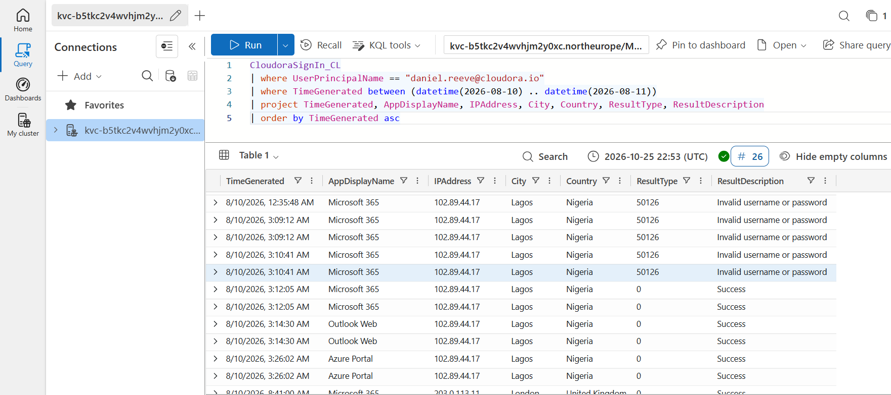
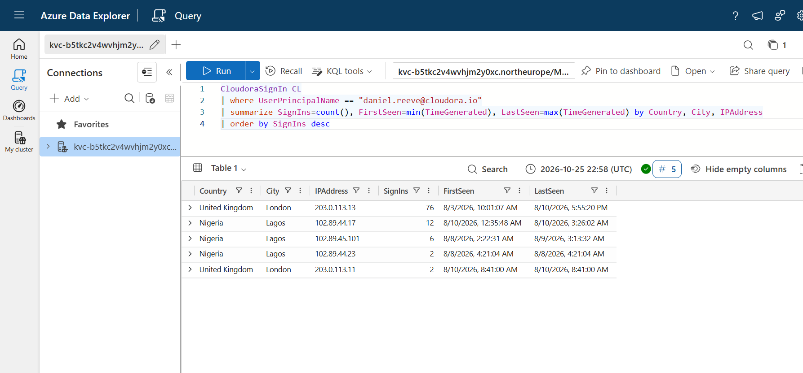
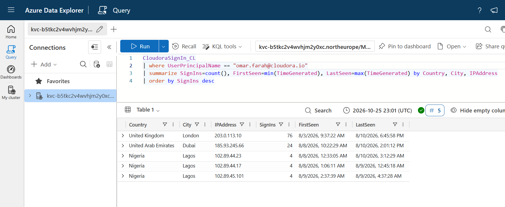
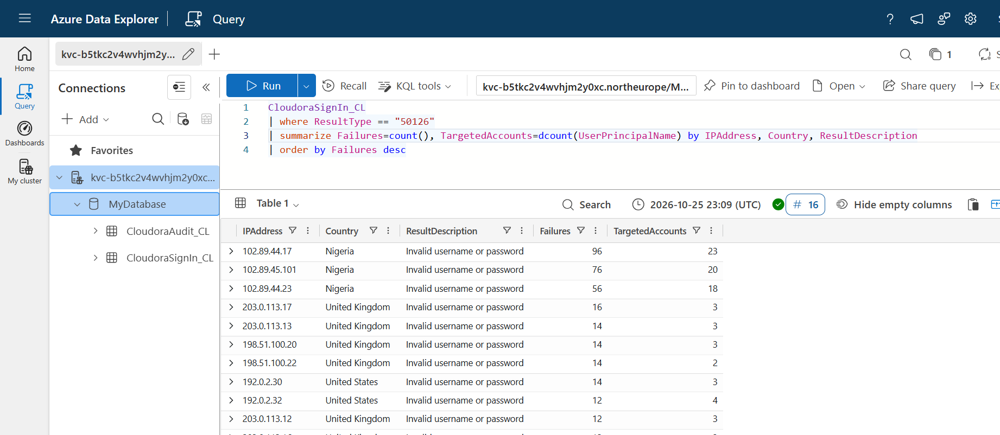
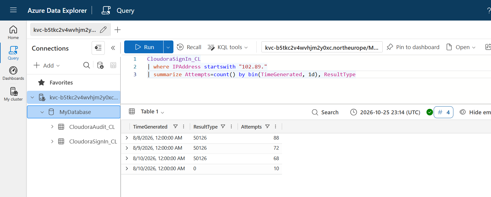
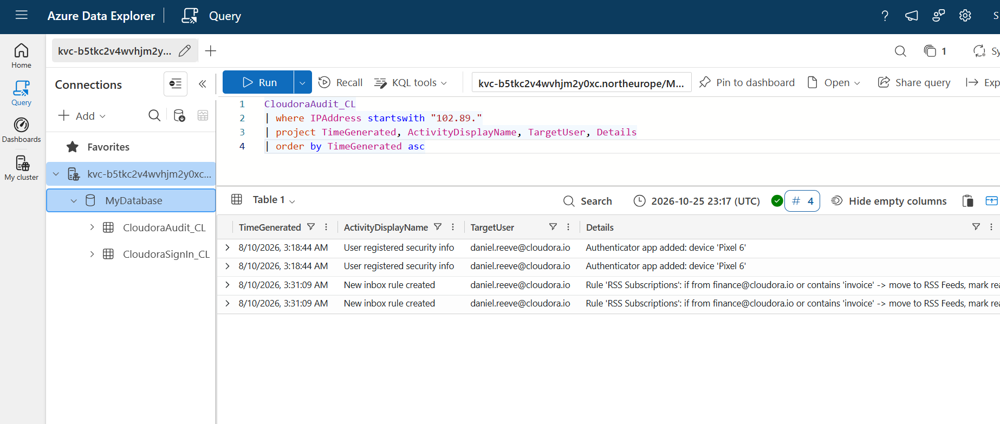
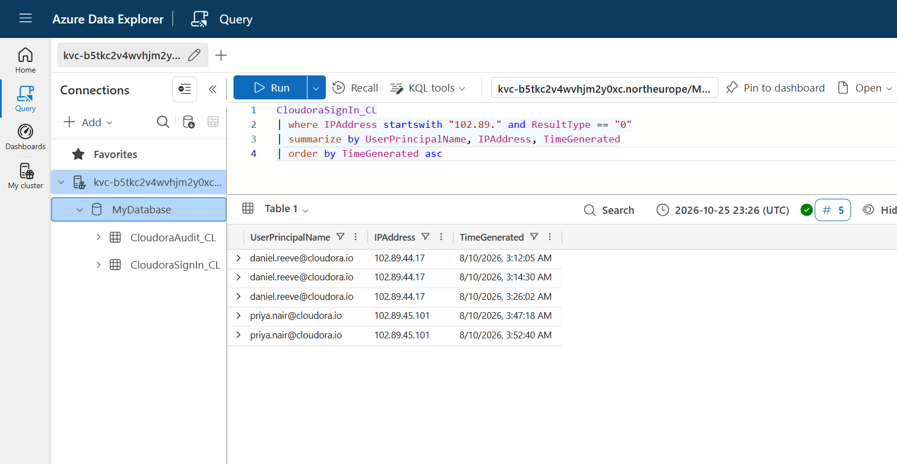
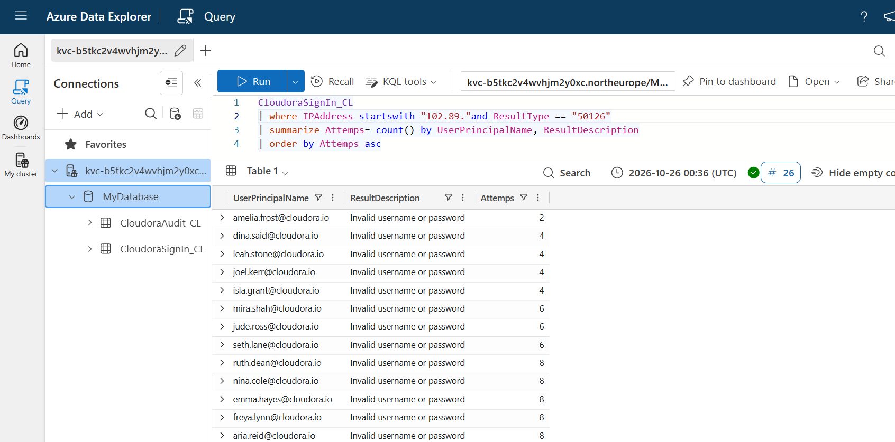
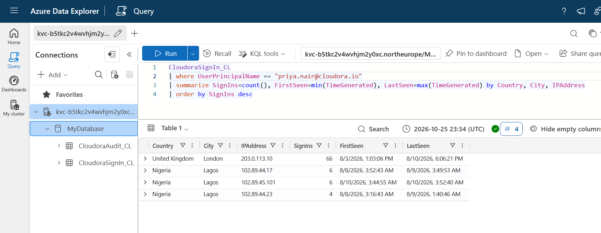

# CEO Account Takeover Investigation

A simulated SOC investigation into an executive account compromise, examining how identity attacks can expose a business to payment fraud, disruption to financial correspondence, and loss of customer confidence.

**Analyst:** Adithyakrishnan Sureshbabu  
**Tools:** Azure Data Explorer and KQL  
**Evidence:** Synthetic Entra ID sign-in and audit logs  
**Scenario:** MyFirstHack / myfirstcyberjob — Cloudora, a fictional company

> This is a training project, not employment or a live client engagement. Containment actions are recommendations; their execution and recovery were not verified.

## Business question

**Could an attacker misuse the CEO’s identity to affect the company’s money, reputation, or pending enterprise deal—and what should the business do next?**

The investigation began with a suspicious sign-in against Cloudora’s CEO. It expanded into a review of a wider credential attack, unauthorised authentication changes, concealed finance messages, and a second compromised account.

My objective was to connect the technical evidence to practical business decisions: whose access needed restricting, which financial communications needed checking, and what further evidence was required before declaring recovery.

## Incident report

[Read the full incident report](report/Cloudora_CEO_Account_Takeover_Incident_Report.pdf)
The report includes an executive summary, UTC timeline, findings, indicators, ATT&CK mapping, scope, response recommendations, and lessons learned.

## Key outcomes

| Entity | Evidence | Assessment |
|---|---|---|
| Daniel Reeve — CEO | Failed attempts followed by successful access, authenticator registration, and finance-mail concealment | Compromised |
| Priya Nair | Successful access from identified attack infrastructure, followed by SharePoint Online sign-in | Second compromised account |
| Omar Farah | Repeated successful Dubai activity consistent with his device/browser history | Legitimate travel; user confirmation would strengthen the assessment |
| Wider target population | 26 distinct accounts received failed attempts from identified infrastructure | Campaign-wide review required |
| Financial and reputational impact | Rule explicitly conceals finance/invoice correspondence | Credible fraud risk; actual loss and customer impact not established |

## Data-quality finding

My imported query results contained apparent duplicate records.

| Metric | Imported results | Supplied source CSV |
|---|---:|---:|
| Failed events from identified infrastructure | 228 rows | 114 events |
| 8 August failures | 88 rows | 44 events |
| 9 August failures | 72 rows | 36 events |
| 10 August failures | 68 rows | 34 events |
| Successful attacker-associated sign-ins | 10 rows | 5 events |
| Distinct targeted accounts | 26 | 26 |

Repeated events are visible in the screenshots. The consistent doubling strongly suggests duplicate ingestion, although ingestion history was not available to confirm the cause.

I distinguish returned rows from source events rather than treating duplicate records as additional attacker activity. The scope query groups by account, IP address, and timestamp, producing five distinct successful combinations across two accounts.

## Investigation workflow and evidence

All incident timestamps below are **UTC, August 2026**.

### 1. Triage the CEO alert

I reviewed Daniel’s sign-ins on the incident day.

Failures at **03:09:12** and **03:10:41** were followed by successful Microsoft 365 access at **03:12:05**, Outlook Web at **03:14:30**, and Azure Portal at **03:26:02**, from `102.89.44.17`.

The sequence established the activity requiring investigation. Geography alone was not treated as proof of compromise.

### 2. Establish Daniel’s baseline

The baseline query returned **78 London rows**, corresponding to **39 source records**. A London sign-in also occurred at **08:41:00** on the incident day.

I assessed this history alongside the failed-then-successful sequence and subsequent account changes. A later London sign-in alone cannot exclude VPN use.

### 3. Compare a potentially benign anomaly

Omar’s account also showed a new country: Dubai.

The screenshot returned **24 Dubai rows**, corresponding to **12 source events** across three days. The source records show successful activity using iOS 17 / Mobile Safari, also present in his London history.

This supports likely legitimate travel. Omar nevertheless remained in scope because the campaign also targeted his account.

### 4. Identify the wider credential attack

Grouping failed sign-ins by source IP and distinct user exposed the campaign.

| Source IP | Imported failure rows | Distinct targeted accounts |
|---|---:|---:|
| `102.89.44.17` | 96 | 23 |
| `102.89.45.101` | 76 | 20 |
| `102.89.44.23` | 56 | 18 |

The account populations overlap. Their combined scope is **26 unique accounts**, not the sum of the three account counts.

The many-account failure pattern is consistent with password spraying. The logs do not reveal attempted password values or independently exclude other credential-theft methods.

### 5. Establish the campaign window

Daily aggregation showed activity across three consecutive nights: **88, 72, and 68 imported failure rows**.

The source CSV contains **44, 36, and 34 corresponding events**. Successful attacker-associated sign-ins occurred on the third night.

### 6. Inspect authentication and mailbox changes

Two important changes appeared in Daniel’s audit records:

- **03:18:44:** Authenticator app added with device name `Pixel 6`.
- **03:31:09:** Inbox rule `RSS Subscriptions` created.

The rule moves messages from `finance@cloudora.io` or containing `invoice` to RSS Feeds and marks them read.

These findings changed the response priorities. Resetting a password would leave the unauthorised method and mail rule configured. The rule also creates a direct business concern: financial conversations or warnings could be hidden from the CEO.

Each audit event appears twice in the screenshot; this does not establish two registrations or two rules.

### 7. Scope successful access beyond the CEO

Filtering identified infrastructure to successful sign-ins revealed:

- Daniel: **03:12:05, 03:14:30, and 03:26:02**.
- Priya: **03:47:18 and 03:52:40**.

This established a second affected identity and prevented the response from stopping at the original alert.

### 8. Inventory all targeted accounts

The target query returned **26 distinct accounts**. Excluding Daniel and Priya leaves **24 accounts with failures only from identified infrastructure**.

That does not prove those accounts were never compromised elsewhere. It defines the review population supported by this evidence.

### 9. Review Priya’s baseline

Priya’s baseline returned **66 London rows**, corresponding to **33 source records**.

Her successful access from attack infrastructure and subsequent SharePoint sign-in require investigation of potentially accessible documents. Application sign-ins alone do not establish which files were viewed or downloaded.

## MITRE ATT&CK mapping

| Tactic | Technique | Evidence |
|---|---|---|
| Credential Access | T1110.003 — Password Spraying | Many-account failure pattern across three nights and three identified IPs |
| Initial Access | T1078 — Valid Accounts | Successful attacker-associated access to Daniel and Priya |
| Persistence | T1098.005 — Device Registration | Unauthorised Pixel 6 authenticator registration |
| Defense Evasion | T1564.008 — Email Hiding Rules | Finance/invoice messages moved out of the inbox and marked read |

## Recommended response

These are proposed actions, not executed changes:

1. Preserve evidence while promptly restricting sign-in and revoking sessions for both affected accounts.
2. Reset credentials through a trusted recovery process.
3. Remove the unauthorised authenticator method and verify legitimate methods on both accounts.
4. Preserve and remove the inbox rule; inspect forwarding, delegates, and other rules.
5. Restrict identified infrastructure as an additional measure and monitor alternative sources.
6. Independently verify suspicious payment requests and banking-detail changes through known contact channels.
7. Review fresh telemetry and live configuration before declaring recovery.

Previously hidden finance messages also require review. Removing the rule does not automatically restore those messages to the inbox.

## What the evidence does not establish

The supplied logs do not prove:

- That money was stolen or payment details were changed.
- That fraudulent emails were sent.
- Which messages or documents were accessed or exfiltrated.
- That customers were affected or the enterprise deal was lost.
- That containment or recovery succeeded.

Further evidence would include mailbox access records, message trace, SharePoint file operations, payment records, and post-remediation telemetry.

## Lessons learned

- **Business context changes priorities.** Finance-mail concealment made payment verification and executive communications central to the response.
- **Scope beyond the first alert.** Campaign-level analysis identified a second compromised account.
- **Validate the data before reporting scale.** Duplicate rows inflated attempt counts while distinct-user counts remained unchanged.
- **Use combined evidence.** Location, authentication sequence, history, and account changes supported stronger conclusions together.
- **Separate plans from verified actions.** Static logs can support an investigation but cannot demonstrate successful remediation.

## Responsible use and attribution

Scenario, synthetic datasets, report template, and query guidance were supplied by the MyFirstHack / myfirstcyberjob community.

The screenshots document my investigation run in Azure Data Explorer. This repository presents my analysis and report for learning and portfolio purposes.

Cloudora is fictional. Indicators are scenario evidence and should not be used to justify blocking addresses in an unrelated real environment.

Original training guides, answer keys, and another participant’s assessment are not included.
